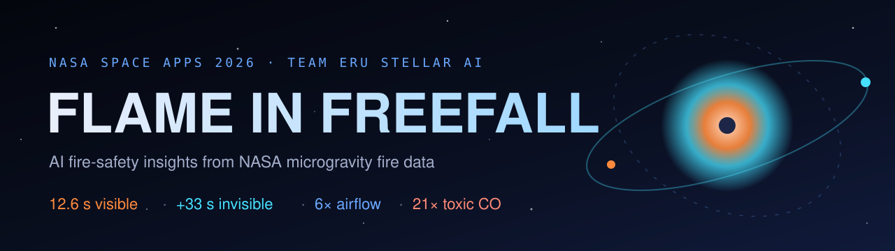
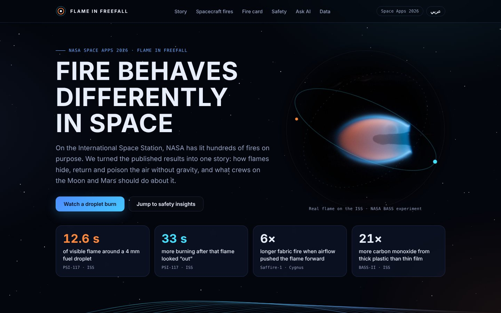
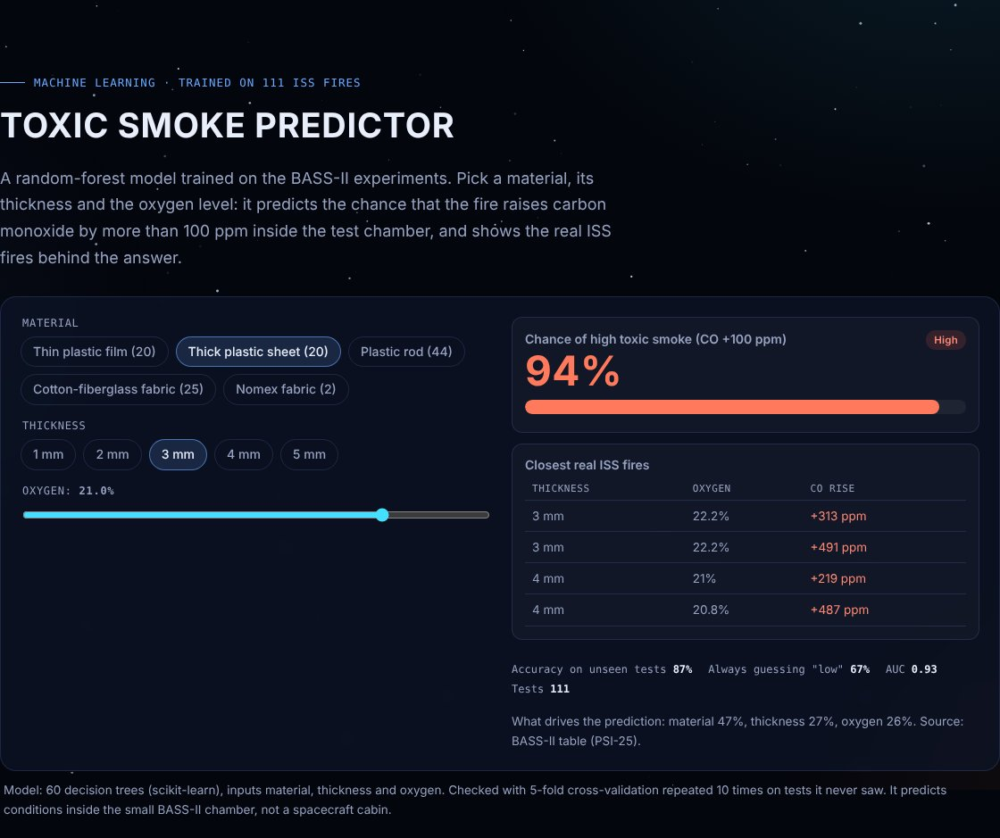
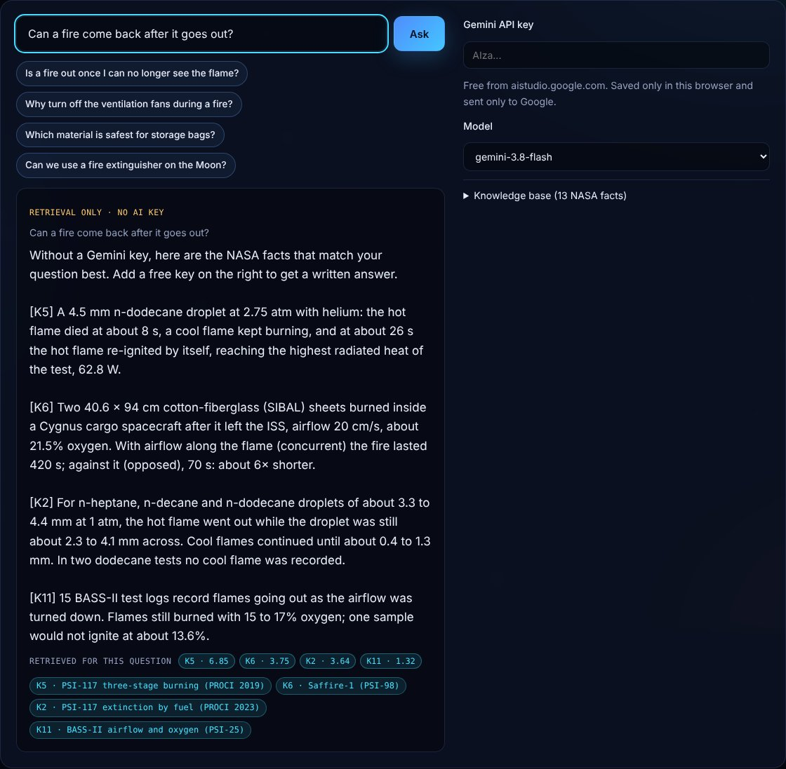
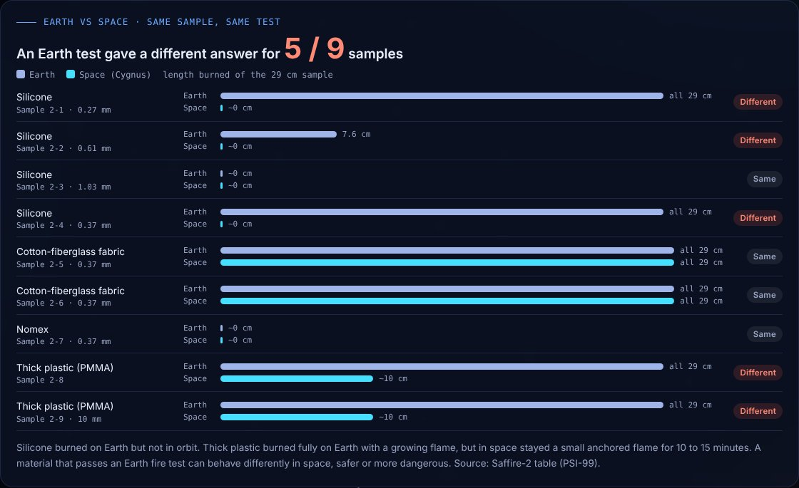
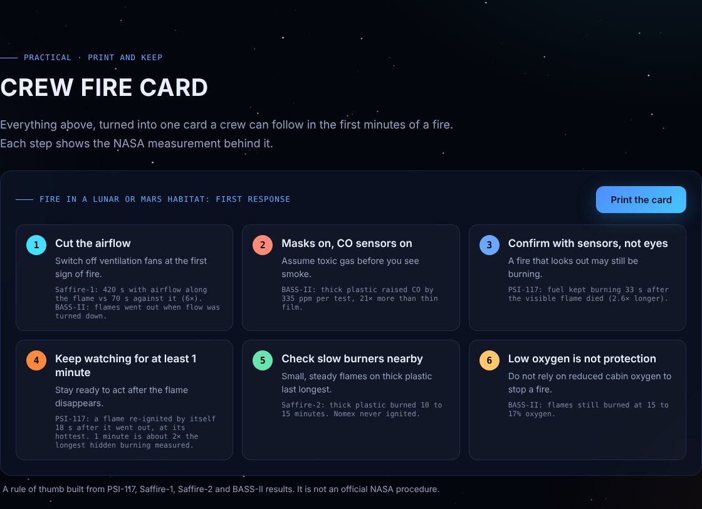
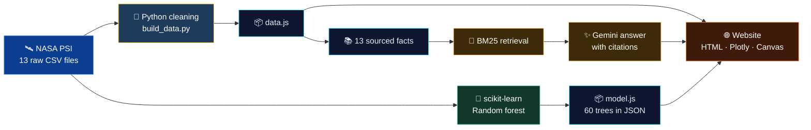

<p align="center">
  
</p>

<p align="center">
  <a href="https://nohakhalednk1.github.io/flame-in-freefall/"></a>
  
  
</p>

<p align="center">
  
  
  
  
  
  
</p>

---

## 🔥 The problem

On Earth, hot gas rises and a flame stretches into a bright teardrop. In orbit nothing rises, so fire becomes a dim, round, often **invisible** ball.
NASA has lit hundreds of fires on the International Space Station on purpose. The results sit in raw tables that crews and mission planners rarely read.

**Flame in Freefall** turns those tables into one interactive website, two kinds of AI, and a fire card a crew could actually use on the Moon or Mars.

## ✨ What we found in the data

| | Finding | NASA source |
|:-:|---|---|
| 🟠 | The visible flame died at **12.6 s**, but the fuel kept burning inside an invisible cool flame for **33 s more** (2.6× longer). | PSI-117 |
| 🔁 | A flame that went out at 8 s **re-ignited by itself at 26 s**, hotter than before. | PSI-117 |
| 🌬️ | The same fabric burned **420 s** with airflow along the flame and **70 s** against it: **6×** longer. | Saffire-1 |
| ☠️ | Thick plastic raised carbon monoxide **21×** more than thin film. Nomex never ignited. | BASS-II, Saffire-2 |
| 🌍 | An Earth fire test gave a **different result in 5 of 9** samples than the same test in space. | Saffire-2 |

## 🧭 Tour of the website

<table>
<tr>
<td width="50%"><br><b>Story + replay.</b> Earth vs orbit candle, a droplet replay driven by ISS measurements with an infrared switch, and 8 data chapters with interactive charts and NASA photos.</td>
<td width="50%"><br><b>🤖 Toxic smoke predictor (ML).</b> A random forest trained on 111 ISS fires predicts the chance of high carbon monoxide and shows the closest real tests.</td>
</tr>
<tr>
<td><br><b>💬 Ask the data (RAG).</b> BM25 retrieval picks the matching NASA facts, then Gemini answers only from them and cites each one. Works in English and Arabic.</td>
<td><br><b>🌍 Earth vs space.</b> Sample by sample, how far each material burned on Earth and in orbit.</td>
</tr>
<tr>
<td><br><b>🧯 Crew fire card.</b> Six first-response steps, each with the measurement behind it. One click prints it.</td>
<td><b>Also inside</b><br>• Material risk check that says "no data" instead of guessing<br>• Full Arabic version, right to left, one click<br>• "Honest limits" section<br>• Every number links to its dataset or paper</td>
</tr>
</table>

## 🧠 How it works



### 🤖 The machine-learning model

| | |
|---|---|
| **Task** | Will a fire raise CO by more than 100 ppm inside the BASS-II test box? |
| **Data** | 111 BASS-II tests from the ISS (PSI-25) |
| **Inputs** | Material, thickness, oxygen % |
| **Model** | Random forest, 60 trees (scikit-learn), exported to JSON and run in the browser |
| **Check** | 5-fold cross-validation, repeated 10 times, on tests the model never saw |
| **Result** | **87% accuracy**, AUC **0.93** (always guessing "low" scores 67%) |

We first tried predicting the exact CO number. It was barely better than a per-material average, so we switched to the risk question above, which the data supports well.

### 💬 The RAG assistant

1. **Retrieve.** A BM25 search over 13 sourced facts (English, Arabic and Egyptian Arabic keywords) picks the best 4, plus a "what the data does not cover" fact.
2. **Generate.** Only those facts go to Gemini, which must cite them as `[K1]`, `[K5]`… and say so when the data does not cover a question.
3. **Show.** Every answer lists the retrieved facts and their scores. With no API key, the site still shows the retrieved facts.

> 🔐 The Gemini key is typed into the website and saved only in the visitor's browser. It is never in this repository.

## 📂 Data

| PSI ID | Experiment | Used for |
|---|---|---|
|  | Droplet combustion on the ISS | Invisible cool flames, re-ignition, pressure |
|  | Saffire-1 | Airflow direction and fire duration |
|  | Saffire-2 | Materials, Earth vs space |
|  | BASS-II | Carbon monoxide, ML model |
|  | Saffire-3, BASS, ACME | Reviewed: setup or logs only, no results |

<details>
<summary><b>🧹 Data cleaning notes</b></summary>

- Saffire-2 thickness typos such as `037 mm` are read as `0.37 mm`; blank material cells take the material of the row above.
- Saffire-2 burn lengths written as words are turned into numbers: `Complete` = 29 cm (the full sample), `~ 0` = 0.
- BASS-II CO rise = final CO − initial CO inside the test box. Candle and spherical samples are left out.
- BASS-II airflow was logged as changing fan settings, so it is not used by the model.
- In the PSI-117 extinction files, 0 means no flame was seen; those points are not plotted.
- The three-stage run uses scaled time t/d₀²; the site converts it with d₀ = 4.5 mm.

</details>

<details>
<summary><b>📄 Papers behind PSI-117</b></summary>

- Cool flames, steady and pulsing: https://doi.org/10.1016/j.proci.2018.05.151
- Three-stage burning: https://doi.org/10.1016/j.proci.2018.09.015
- Extinction size and pressure: https://doi.org/10.1016/j.proci.2022.07.094
- Burn history, burning rate, radiation: https://doi.org/10.1007/s12217-024-10115-x

</details>

## ⚠️ Honest limits

- Small samples: 9 Saffire-2 samples, 2 Nomex tests in BASS-II, 111 tests for the model.
- BASS-II CO was measured in a small test box, not a spacecraft cabin.
- Not tested: lunar or Martian gravity, extinguishers, oxygen above about 22%.
- The fire card, risk check and predictor are rules of thumb, not certified NASA procedures.

## 💻 Run it yourself

```bash
# 1. Rebuild the data (Python standard library only)
python scripts/build_data.py

# 2. Retrain the model (needs numpy and scikit-learn)
pip install numpy scikit-learn
python ml/export.py          # writes docs/model.js and prints the cross-validation scores

# 3. Open the website
cd docs
python -m http.server 8000   # then open http://localhost:8000
```

```
data/raw/               original NASA PSI files
scripts/build_data.py   cleaning → docs/data.js
ml/parse.py             reads BASS-II into model features
ml/export.py            trains, cross-validates and exports the model → docs/model.js
docs/index.html         the website
docs/img/               NASA photos and README images
```

## 👩‍🚀 Built by Team ERU Stellar AI

<p align="center"><sub>Data and photos: NASA Physical Sciences Informatics (psi.nasa.gov) and images.nasa.gov · Built for the NASA Space Apps Challenge 2026</sub></p>
